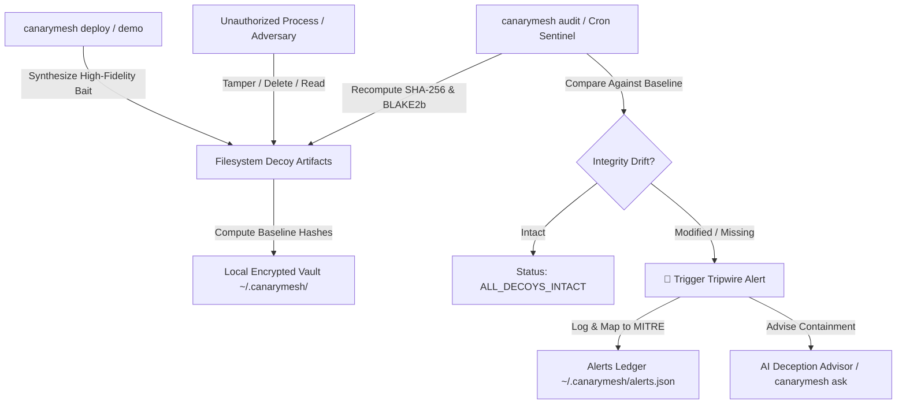

<div align="center">
  <div>&nbsp;</div>
  # 🪤 CanaryMesh Core
  ### Local-First Defensive Decoy File Generator, Integrity Tripwires & Tampering Sentinel

  [](#)
  [](#)
  [](#)
  [](#)
  [](#)
</div>

---

> **⚠️ NOTE:** This project is for Proof of Concept (POC) and educational defense-in-depth purposes only. It is not intended as a replacement for managed commercial EDR solutions. Ensure all decoy deployments comply with organizational monitoring policies.

---

## 📖 Overview

**CanaryMesh Core** is an enterprise-grade, privacy-preserving, 100% local-first deception framework and file integrity sentinel. It empowers security engineers, homelab operators, and blue-team defenders to plant high-fidelity defensive decoy artifacts (honey-tokens, decoy SSH backup keys, fake cloud credentials, `.env` staging secrets, and sensitive canary documents) across local workspaces and servers.

When an unauthorized insider or compromised process performs host reconnaissance, accesses, modifies, or deletes a canary file, CanaryMesh detects cryptographic baseline drift in sub-milliseconds and raises actionable alerts mapped directly to **MITRE ATT&CK** techniques.

### 🔑 Key Architectural Capabilities

- **🔒 100% Local-First & Zero Cloud Accounts:** Operates completely offline on local storage (`~/.canarymesh/`) with zero telemetry, no external callbacks required, and zero sensitive data leakage.
- **🎯 Multi-Category Decoy Synthesizer:** Plants realistic bait files across high-value adversary targets:
  - `aws_credentials` (`~/.aws/credentials`)
  - `ssh_key` (decoy encrypted OpenSSH private keys)
  - `env_secrets` (synthetic production `.env` files with mock DB & API secrets)
  - `database_config` (fake PostgreSQL/MySQL connection strings pointing to honeynets)
  - `api_token` (decoy Stripe, Slack, and OpenAI credentials)
  - `sensitive_document` (confidential executive strategy & financial M&A bait)
- **⚡ Dual Cryptographic Integrity Baseline:** Automatically fingerprints all deployed artifacts with dual **SHA-256** and **BLAKE2b** hashes to identify tampering, truncations, or deletions.
- **🛡️ MITRE ATT&CK Mapping:** Translates detected file anomalies into industry-standard defensive tactics (e.g., `T1552.001`, `T1552.004`, `T1070.004`, `T1565.001`).
- **🤖 Pluggable AI Deception Advisor:** Features a built-in deterministic offline deception advisor and an extensible client-side adapter for local LLMs (Ollama, vLLM) with automatic PII sanitization.
- **⚡ Interactive Beginner Quickstart:** Ships with an out-of-the-box `demo` subcommand to seed a complete multi-layered deception environment in under 30 seconds.

---

## 🏗️ Architecture Workflow



---

## ⚡ 30-Second Beginner Quickstart

Test the full deception workflow out-of-the-box with zero prior configuration:

```bash
# 1. Clone & install
git checkout canarymesh-core
pip install -e .

# 2. Seed an interactive multi-layer deception scenario (AWS, SSH, .env, M&A Docs)
canarymesh demo

# 3. Inspect active armed decoys
canarymesh list

# 4. Audit baseline integrity (all pass)
canarymesh audit

# 5. Simulate an attacker modifying a decoy file
echo "UNAUTHORIZED_MODIFICATION" >> ~/.canarymesh/demo_environment/.aws/credentials

# 6. Run audit again to observe instant breach detection
canarymesh audit

# 7. Consult the AI Deception Advisor for containment instructions
canarymesh ask "What containment actions should I execute after this breach?"
```

---

## 🛠️ CLI Command Reference

| Subcommand | Description | Example |
|---|---|---|
| `deploy` | Synthesize and arm a new decoy tripwire file | `canarymesh deploy --category aws_credentials --path ~/.aws/credentials` |
| `register` | Fingerprint and track an existing file under tripwire auditing | `canarymesh register --path /data/confidential.pdf --category sensitive_document` |
| `audit` | Recompute cryptographic hashes across all decoys and report drift | `canarymesh audit [--json] [--quiet]` |
| `list` | View all active monitored decoy artifacts and paths | `canarymesh list [--json]` |
| `alerts` | Review logged tripwire breach incidents or clear the ledger | `canarymesh alerts [--clear] [--json]` |
| `ask` | Query the AI Deception Advisor for posture analysis or incident response | `canarymesh ask "Explain MITRE coverage for our decoys"` |
| `demo` | Seed realistic multi-category honey-tokens for hands-on evaluation | `canarymesh demo [--force]` |

---

## 🤖 Connecting Your Own Local AI / LLM (Ollama, vLLM, OpenAI)

CanaryMesh includes a deterministic offline rule engine by default. To connect a local LLM via Ollama or vLLM:

```python
import json
import urllib.request
from canarymesh.advisor import CanaryMeshAdvisor
from canarymesh.storage import DecoyStore

def query_ollama(prompt: str, context: dict) -> str:
    payload = json.dumps({
        "model": "mistral",
        "prompt": f"System: You are a defensive deception engineer.\nContext: {json.dumps(context)}\nUser: {prompt}\nResponse:",
        "stream": False
    }).encode("utf-8")
    req = urllib.request.Request("http://localhost:11434/api/generate", data=payload, headers={"Content-Type": "application/json"})
    with urllib.request.urlopen(req) as resp:
        return json.loads(resp.read().decode())["response"]

store = DecoyStore()
advisor = CanaryMeshAdvisor(custom_llm_callable=query_ollama)
response = advisor.consult("Advise on isolating the host after credentials tampering", store.list_decoys(), store.list_alerts())
print(response.threat_assessment)
```

---

## 📋 Comprehensive Multi-Phase Implementation Guide

### Phase 1: Threat Modeling & Decoy Strategy
Identify high-value paths in your homelab or production environment:
1. `~/.aws/credentials` — Targets automated credential harvesters.
2. `~/.ssh/id_rsa_backup` — Targets lateral movement recon.
3. `.env.production` inside developer repositories — Targets rogue dependencies or repo scrapers.

### Phase 2: Automated Deployment & Permission Lockdown
Ensure decoy files have restricted permissions (`chmod 600`) so unprivileged users cannot read or modify them without triggering an access or integrity alert.

### Phase 3: Periodic Audit Automation via Cron
Schedule recurring audits to monitor integrity automatically:
```bash
# Run silent audit every 15 minutes; logs only on tampering or drift
*/15 * * * * canarymesh audit --quiet >> /var/log/canarymesh_cron.log 2>&1
```

---

## ⚖️ Disclaimers & Fair Use

- **Defensive & Educational Use Only:** CanaryMesh Core is designed exclusively for authorized defensive cyber deception, blue-team monitoring, and educational research. It contains zero offensive exploit code, malware, or backdoors.
- **No Production Warranty:** Provided "AS IS" under the MIT License without warranties of any kind.
- **Nominative Fair Use:** Third-party brand and service names (AWS, SSH, Stripe, Slack, PostgreSQL, MITRE) are used strictly for nominative identification and interoperability. CanaryMesh is not affiliated with, sponsored by, or endorsed by any of these entities.
