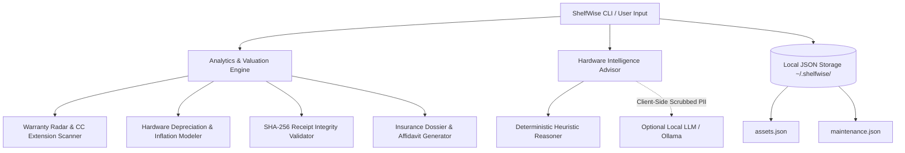

<div align="center">
  <div>&nbsp;</div>
  <h1>📦 ShelfWise</h1>
  <p><strong>Local-First Hardware Asset Inventory, Warranty Radar & Insurance Claims Packager</strong></p>

  [](#)
  [](LICENSE)
  [](#)
  [](https://github.com/astral-sh/ruff)
  [](#)
</div>

---

## 🌟 Overview

**ShelfWise** (`shelfwise-core`) is a privacy-preserving, 100% offline hardware asset management system designed for homelab operators, developers, power users, and households. It tracks equipment lifecycles, monitors warranty cliffs, verifies cryptographic proof-of-purchase receipt files, records RMA and maintenance histories, and automatically compiles insurer-ready loss/damage claim dossiers.

### Why ShelfWise?
- 🔒 **100% Local-First & Zero Cloud Accounts:** Runs entirely on your local machine (`~/.shelfwise/`). No account registrations, telemetry, or remote database synchronization.
- 🛡️ **Warranty Expiration Radar:** Calculates exact countdowns across 4 urgency tiers (`CRITICAL` $\le$ 14d, `WARNING` $\le$ 45d, `ACTIVE`, `EXPIRED`, `LIFETIME`) and flags secondary credit card extended warranty protection opportunities.
- 🧾 **Cryptographic Receipt Integrity:** Links local invoice PDFs/images and computes SHA-256 hashes to guarantee un-tampered proof of purchase for warranty and insurance claims.
- 📉 **Depreciation & Valuation Engine:** Computes real-time fair market value (using hardware depreciation curves) and estimated replacement costs adjusted for electronics inflation.
- 📄 **1-Click Insurance Claim Packager:** Generates comprehensive Markdown and JSON claim bundles complete with serial numbers, replacement cost estimates, verified receipt hashes, and formal claim affidavits.
- 🔧 **Maintenance, RMA & Lemon Asset Tracker:** Logs repairs, upgrades, firmware updates, and RMA tickets, detecting "lemon" devices whose cumulative repair costs exceed sensible thresholds.
- 🤖 **Offline AI Hardware Advisor:** Ships with deterministic heuristic fleet analysis, and features a pluggable client-side adapter for local LLMs (Ollama, vLLM) with automatic serial number and PII scrubbing.

---

## 🏗️ Architecture



---

## ⚡ 30-Second Beginner Quickstart

### Step 1: Install ShelfWise
```bash
git checkout shelfwise-core
pip install -e .
```

### Step 2: Register a Hardware Device
```bash
shelfwise add \
  --name "Mac Mini M2 Homelab" \
  --category homelab \
  --brand "Apple" \
  --model "A2686" \
  --serial "C02XYZ12345" \
  --price 599.00 \
  --purchase-date 2024-01-15 \
  --warranty-months 12 \
  --location "Rack 1"
```

### Step 3: Run Warranty Radar & Fleet Audit
```bash
# View active, expiring, and credit card claimable warranties
shelfwise warranty

# Run full financial and insurance risk audit
shelfwise audit
```

---

## 📖 Feature & Operations Guide

### Phase 1: Hardware Cataloging & Asset Registry
Catalog workstations, servers, networking switches, cameras, monitors, and tools with full serial number tracking and location tagging:

```bash
# Add network switch
shelfwise add --name "UniFi Switch 24 PoE" --category networking --brand "Ubiquiti" --price 379.00 --purchase-date 2023-06-01 --warranty-months 24 --location "Network Rack"

# List assets by category
shelfwise list --category networking

# Inspect complete specifications and maintenance log
shelfwise show unifi-switch-24-poe
```

### Phase 2: Warranty Radar & Credit Card Protection Perks
Manufacturer warranties often expire unnoticed right before hardware failure. Many premium credit cards (e.g. Chase Sapphire, American Express, Capital One) provide +1 additional year of extended warranty coverage for purchases made on the card:

```bash
# Inspect warranties expiring within 30 days
shelfwise warranty --days 30

# Filter by urgency tier
shelfwise warranty --tier critical
```

### Phase 3: Cryptographic Proof of Purchase
Attach local digital receipts or invoice PDFs. ShelfWise hashes the file using SHA-256 to ensure that purchase records cannot be lost, misplaced, or contested:

```bash
# Register an asset with an official invoice
shelfwise add --name "Dell UltraSharp 32 4K" --price 899.00 --receipt ~/Receipts/dell_u3223qe.pdf

# Audit missing receipts on high-value assets
shelfwise receipts --missing-only
```

### Phase 4: Maintenance, RMA & Lemon Asset Tracking
Keep a log of component upgrades, thermal repasting, battery replacements, and RMA support tickets:

```bash
# Log a fan repair event
shelfwise log-maintenance \
  --asset-id "mac-mini-m2-homelab" \
  --type repair \
  --cost 45.00 \
  --desc "Replaced chassis blower fan"

# Review maintenance history across the fleet
shelfwise maintenance-history
```

### Phase 5: 1-Click Insurance & Warranty Claim Packager
In the event of theft, power surge, water leak, or transit damage, generate an adjuster-ready claims packet formatted with serial numbers, replacement values, verified receipt hashes, and checklists:

```bash
# Generate insurance claim pack for all active assets
shelfwise claim-pack --incident theft_or_loss --output insurance_claim_dossier.md

# Generate claim pack for a single damaged asset
shelfwise claim-pack --asset-id "mac-mini-m2-homelab" --incident power_surge --output surge_claim.md
```

---

## 🤖 Connecting Your Own Local AI / LLM (Ollama, vLLM, OpenAI)

ShelfWise features a **deterministic offline rule-based advisor** by default (`shelfwise ask "<query>"`). You can easily attach local Ollama, vLLM, or custom models using a lightweight 3-line Python adapter. ShelfWise automatically masks serial numbers, invoice IDs, and local file paths before passing context:

```python
from shelfwise.advisor import HardwareAdvisor
from shelfwise.storage import ShelfWiseStorage

# 1. Define custom LLM callable (e.g. Ollama or local endpoint)
def query_ollama(prompt: str, context: dict) -> str:
    import urllib.request, json
    payload = json.dumps({"model": "llama3", "prompt": f"{prompt}\nContext: {json.dumps(context)}", "stream": False}).encode()
    req = urllib.request.Request("http://localhost:11434/api/generate", data=payload, headers={"Content-Type": "application/json"})
    with urllib.request.urlopen(req) as resp:
        return json.loads(resp.read())["response"]

# 2. Consult advisor with client-side scrubbed context
storage = ShelfWiseStorage()
advisor = HardwareAdvisor(custom_llm_callable=query_ollama)
response = advisor.consult("What servers need preventative maintenance?", storage.list_assets(), storage.list_maintenance())

print(response.summary)
```

---

## ⚠️ Proof of Concept Notice

> **⚠️ NOTE:** This project is for Proof of Concept (POC) purposes only. It is not intended for production enterprise asset lifecycle infrastructure. Ensure all hardware serial numbers, receipt files, and insurance claim submissions are manually verified against physical property before submitting legal or insurance affidavits.

---

## ⚖️ Disclaimers & Fair Use

### Non-Insurance & Non-Financial Advice Disclaimer
ShelfWise is provided solely for personal inventory tracking, organizational utility, and educational purposes. **ShelfWise is not an insurance carrier, adjuster, underwriter, or financial advisor.** It does not guarantee claim approval, coverage validation, or indemnification under any commercial or homeowners policy.

### Nominative Fair Use
All product names, brand names, and trademarks mentioned herein (including Apple, Dell, Sony, Ubiquiti, Cisco, Chase, American Express, Capital One, and others) are the property of their respective holders. Use of them does not imply any affiliation with, sponsorship by, or endorsement by them.

### Limitation of Liability & "AS IS" Warranty
THE SOFTWARE IS PROVIDED "AS IS", WITHOUT WARRANTY OF ANY KIND, EXPRESS OR IMPLIED, INCLUDING BUT NOT LIMITED TO THE WARRANTIES OF MERCHANTABILITY, FITNESS FOR A PARTICULAR PURPOSE AND NONINFRINGEMENT. IN NO EVENT SHALL THE AUTHORS OR COPYRIGHT HOLDERS BE LIABLE FOR ANY CLAIM, DAMAGES OR OTHER LIABILITY, WHETHER IN AN ACTION OF CONTRACT, TORT OR OTHERWISE, ARISING FROM, OUT OF OR IN CONNECTION WITH THE SOFTWARE OR THE USE OR OTHER DEALINGS IN THE SOFTWARE.

### Clean-Room & Originality Standard
All code, models, and CLI routines in ShelfWise are 100% original, clean-room implementations developed without proprietary snippets, reverse engineering, or illicit dependencies.
